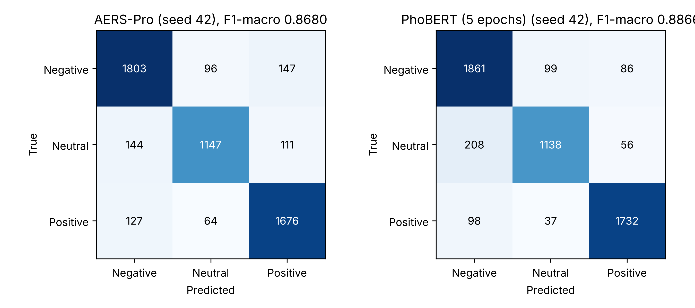
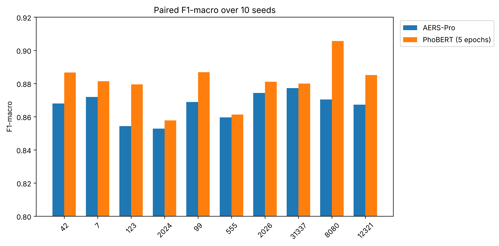

# Supplementary material for "A Hybrid Machine Learning Framework for Vietnamese Sentiment Analysis in E-Commerce" (QNUJS-B2662)

All numbers are means over the ten matched seeds unless stated otherwise, and are generated from the files in `tables/` and `results/`. Main comparison: PhoBERT-base-v2, 5 epochs (per-sample logits in `results/phobert_logits/`). Sensitivity: up to 8 epochs (per-seed aggregates in `tables/*_8ep.csv`).

## S1. Algorithm 1 and hyperparameters

### Algorithm 1: fitting and selection protocol (per seed s)

```text
Input: corpus D with labels and near-duplicate groups G; seed s
1.  (train, cal, test) <- one fold of StratifiedGroupKFold(5, shuffle, s), then of StratifiedGroupKFold(4, shuffle, s) on the remainder; groups never split
2.  Optuna TPE (30 trials, seed s): draw (ngram, max_features, hash_dim, sublinear, C_LR);
      objective = mean macro-F1 of balanced LR over StratifiedGroupKFold(3) on train, feature pipeline refitted in each fold
3.  Fit feature pipeline F on train with the best hyperparameters (TF-IDF, hashing, lexicon, POS; MinMax scalers fitted on train)
4.  For each of 5 StratifiedGroupKFold folds of train: refit a pipeline on the fold-train part; fit LR, LinearSVC (inner sigmoid
      calibration, 3 group-aware folds) and LightGBM; store out-of-fold class probabilities for the held-out part
5.  Refit LR, LinearSVC, LightGBM on all of train with F; fit k-means (k = 4) on train surface statistics; cluster one-hots for all rows
6.  Meta input z = [p_LR | p_SVM | p_LGBM | cluster one-hot | scaled lexicon]; for C in {0.01, 0.1, 1, 5, 10} fit the LR meta-learner on OOF z,
      keep the C with the best macro-F1 on cal
7.  T <- argmax over {0.5, ..., 3.0} of mutual information between 1[|pos - neg| < T] and the label on cal (indicator enters the lexicon block)
8.  Fit the multiclass Platt calibrator on cal: clip p to [1e-6, 1 - 1e-6], l = log(p/(1 - p)), multinomial LR (L2, C = 1, 2000 iterations) on l
9.  Keep the calibrator iff ECE_cal decreases and F1_cal drops by at most 0.005; otherwise use the raw meta-learner probabilities
10. Evaluate once on test: F1-macro, accuracy, ECE (10 bins), Brier, subgroup and per-class metrics
```

### Table S1. Optuna search space (30 trials per seed) and selected values (published run)

| Hyperparameter | Search space | Selected (10 seeds) |
|---|---|---|
| Word n-gram range | (1,2), (1,3), (1,4) | (1,2) in 9 seeds, (1,3) in 1 |
| TF-IDF max features | 8,000-20,000 (steps of 1,000) | 12,000-20,000; upper bound reached in 4 seeds |
| Hashing dimension (char_wb, 2-4-grams) | 2^14 or 2^15 | 16,384 in 8 seeds, 32,768 in 2 |
| Sublinear TF | True / False | False in 6 seeds, True in 4 |
| Logistic Regression C | log-uniform, 0.1-10 | 5.67-9.77 |
| Fixed: LinearSVC | C = 1, balanced, 2,000 iterations | - |
| Fixed: LightGBM | library defaults, balanced | - |
| Meta-learner C (calibration split) | {0.01, 0.1, 1, 5, 10} | chosen per seed |
| Neutral threshold T (calibration split) | {0.5, 1.0, 1.5, 2.0, 2.5, 3.0} | 2.0 in 8 seeds; 1.5 and 3.0 in one each |
| Software (re-run environment) | Python 3.12, scikit-learn 1.6.1, LightGBM 4.6.0, Optuna, underthesea 9.5.0, NumPy 2.1.3, SciPy 1.16.3, pandas 2.3.3 (`t10/pip_freeze.txt`) |  |

## S2. Equivalence margins and calibration variants

### Table S2a. TOST p-values for F1-macro (corrected variance; equivalence if p < 0.05)

| Margin (+/-) | 0.005 | 0.01 | 0.015 | 0.02 | 0.03 |
|---|---|---|---|---|---|
| PhoBERT 5 epochs (main) | 0.881 | 0.707 | 0.448 | 0.213 | 0.026 |
| Sensitivity: up to 8 epochs | 0.930 | 0.814 | 0.601 | 0.345 | 0.056 |

### Table S2b. Calibration variants

| System | F1-macro | ECE | Brier |
|---|---|---|---|
| AERS-Pro, published run (calibrator retained in 4/10 seeds) | 0.8665 | 0.0241 | 0.1946 |
| AERS-Pro, re-run: raw stacking | 0.8622 | 0.0262 | 0.1984 |
| AERS-Pro, re-run: + temperature scaling | 0.8622 | 0.0246 | 0.1986 |
| AERS-Pro, re-run: + Platt 3x3 (always on) | 0.8645 | 0.0247 | 0.1955 |
| AERS-Pro, re-run: conditional rule | 0.8628 | 0.0249 | 0.1980 |
| PhoBERT 5 epochs (main), raw | 0.8805 | 0.1088 | 0.2216 |
| PhoBERT 5 epochs + temperature scaling | 0.8805 | 0.0411 | 0.1958 |
| PhoBERT 5 epochs + Platt 3x3 | 0.8813 | 0.0287 | 0.1925 |
| Sensitivity: up to 8 epochs, raw | 0.8834 | 0.1069 | 0.2177 |
| Sensitivity: up to 8 epochs + temperature scaling | 0.8834 | 0.0314 | 0.1940 |
| Sensitivity: up to 8 epochs + Platt 3x3 | 0.8834 | 0.0225 | 0.1919 |

Sensitivity run (up to 8 epochs): F1-macro difference AERS-Pro - PhoBERT = -0.0169, 95% CI [-0.0337, -0.0002], p = 0.048, Holm 0.095 (`tables/tests_nadeau_bengio_8ep_holm.csv`).

## S3. Sensitivity to residual near-duplicates (word-TF-IDF proxy space; PhoBERT 5 epochs)

| Test subset | Share of test set removed | F1 AERS-Pro | F1 PhoBERT | dF1 [95% CI] | ECE AERS-Pro / PhoBERT |
|---|---|---|---|---|---|
| All reviews | 0 | 0.8665 | 0.8805 | −0.0140 [−0.0302, +0.0021] | 0.0241 / 0.1088 |
| excluding train similarity >= 0.99 | 0.4% | 0.8663 | 0.8803 | −0.0141 [−0.0305, +0.0023] | 0.0241 / 0.1090 |
| >= 0.95 | 4.4% | 0.8602 | 0.8745 | −0.0143 [−0.0315, +0.0028] | 0.0248 / 0.1134 |
| >= 0.90 | 14.4% | 0.8406 | 0.8560 | −0.0154 [−0.0361, +0.0053] | 0.0287 / 0.1246 |

Similarity is computed in a word-TF-IDF proxy space on normalised text, not in the exact feature space of either model; duplicate groups used for splitting were not rebuilt from normalised text.

## S4. Deployment cost (full table)

| Quantity | AERS-Pro | PhoBERT-base-v2 |
|---|---|---|
| Serialised model size | 6.53 +/- 0.86 MB (published run); 7.44 MB (5.95-8.27) in the re-run | 516.95 MB (135 M parameters) |
| Size ratio | about 79x smaller (69x with the re-run bundles) | - |
| Training time (descriptive) | 1,890 +/- 31 s, CPU only (4 vCPU), incl. 30-trial Optuna search, OOF stacking and calibration | 1,658 +/- 13 s for the 5-epoch main run on 2x NVIDIA T4 (fp16) |
| Single-review CPU latency, median (p95) | 171 ms (511 ms) | 87 ms (194 ms) |
| Batched CPU inference | 24.4 ms/review (batch 32); 5.5 ms (batch 256); 3.9 ms (batch 1,000) | not reported |

Measured on one seed (42, re-run bundle) and one CPU (Intel Xeon 2.2 GHz, 4 vCPU, 31 GB RAM). AERS-Pro timings are end-to-end from raw text including preprocessing and POS tagging; PhoBERT timings exclude word segmentation and used a randomly initialised classification head. Peak memory was not measured. Raw outputs: `t10/`.

## S5. Agreement between the original labels and the second annotator (n = 500)

| Original \ Annotator 2 | negative | neutral | positive | Total |
|---|---|---|---|---|
| negative | 143 | 6 | 1 | 150 |
| neutral | 48 | 148 | 4 | 200 |
| positive | 5 | 2 | 143 | 150 |

Cohen kappa 0.8026 (bootstrap 95% CI 0.758-0.845), linearly weighted 0.8355, raw agreement 86.8%; one-vs-rest kappa 0.737 (negative), 0.741 (neutral), 0.943 (positive). The sample is stratified by the first annotator label; 24 of the 500 reference labels were revised by the first author after re-examining the 48 conflicting neutral cases (not independent; kappa is computed against the original labels). Files: `t01_annotation/`.

## S6. Per-class results and figures

### Table S6. Per-class results (PhoBERT 5 epochs)

| Class | AERS-Pro (P / R / F1) | PhoBERT (P / R / F1) | dF1 [95% CI] | p (Holm) |
|---|---|---|---|---|
| negative | 0.839 / 0.868 / 0.853 | 0.852 / 0.899 / 0.874 | −0.0214 [−0.0429, +0.0001] | 0.102 |
| neutral | 0.871 / 0.817 / 0.843 | 0.894 / 0.796 / 0.841 | +0.0013 [−0.0328, +0.0353] | 0.935 |
| positive | 0.901 / 0.907 / 0.904 | 0.918 / 0.935 / 0.926 | −0.0220 [−0.0374, −0.0065] | 0.032 |

### Figure S1. Confusion matrices, seed 42 (AERS-Pro published run; PhoBERT 5 epochs)



### Figure S2. Paired F1-macro over the ten seeds



## S7. Illustrative cases (AERS-Pro, seed 42)

| Review (gloss) | Gold -> predicted (max probability) |
|---|---|
| "qua bat mat, nhung ma mau hoi nhat so voi anh ne" (very eye-catching, but the colour is a bit lighter than in the photo) | neutral -> neutral (0.969) |
| "Kieu dang dep nhung chat luong va cach may qua k duoc. Thoi gian giao hang rat nhanh nhe" (nice design, but quality and stitching are bad; delivery is very fast) | negative -> positive (0.895) |
| "noi khong dep thi la noi doi" (saying it is not pretty would be a lie, i.e. it is pretty) | positive -> negative (0.908) |

The first case shows the contrast mechanism working as intended. The second is a rule failure: tuned for two-clause contrast, it under-weights a mid-sentence complaint while an unrelated final clause on shipping receives full weight. The third is a negation-scope failure: the direct negative cue is flagged, but clause-scope handling misses the meta-linguistic frame that reverses its polarity. Probabilities are from `results/v40_probs/v40_test_seed_42.csv` (original Vietnamese text with diacritics is in `data/dataset_cleaned_masked.csv`).
